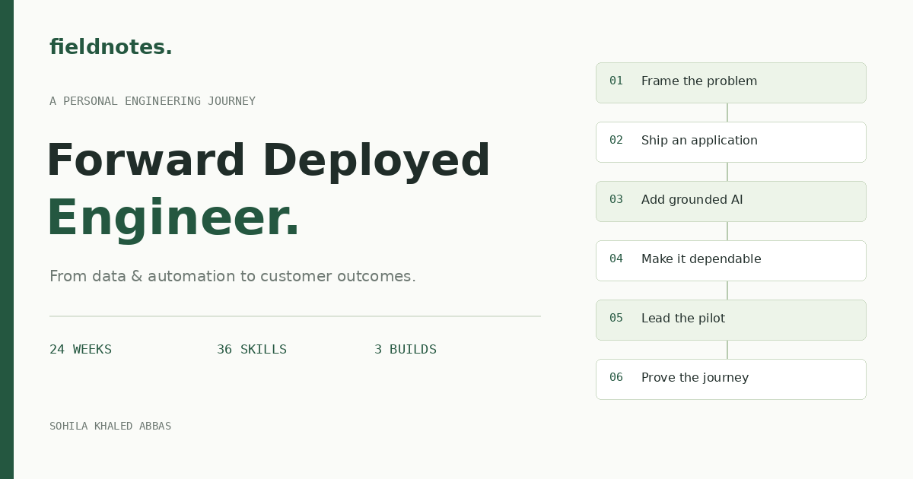
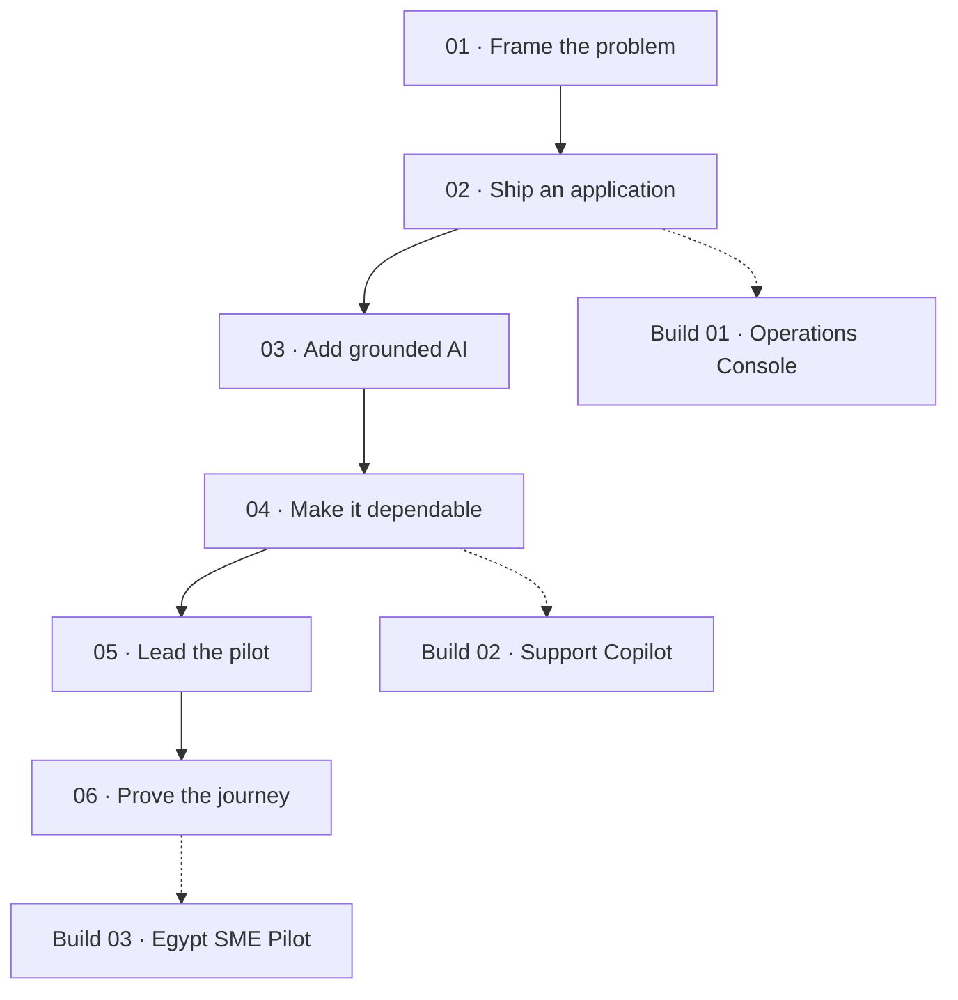

<div align="center">


# Forward Deployed Engineer Roadmap

**From data & automation to customer outcomes.**

A personal learning path for **Sohila Khaled Abbas**, built around Python, SQL, Power BI, analytics engineering, and n8n.

[](https://sohila-khaled-abbas.github.io/forward-deployed-engineer-roadmap/)
[](https://github.com/Sohila-Khaled-Abbas/forward-deployed-engineer-roadmap/actions/workflows/pages.yml)


[Interactive website](https://sohila-khaled-abbas.github.io/forward-deployed-engineer-roadmap/) · [Full roadmap](docs/roadmap.md) · [Weekly plan](docs/weekly-plan.md) · [Portfolio builds](docs/projects.md) · [Sources](docs/sources.md)



</div>

> [!NOTE]
> **The direction:** data and AI integration delivery. Keep your existing strengths and add the engineering, discovery, and operational skills needed to own a customer workflow.

## A focused Python branch

[**Python Learning Roadmap**](https://sohila-khaled-abbas.github.io/python-learning-roadmap/) connects Boot.dev’s twelve chapters, ITI Arabic and Harvard CS50P with original exercises, pandas/SQL practice and three data project briefs. Use it to strengthen the Python service-skill node, then return to this customer-delivery path. [Python source repository](https://github.com/Sohila-Khaled-Abbas/python-learning-roadmap).

## The learning path

| Stage | Weeks | What you demonstrate |
| --- | --- | --- |
| **01 · Frame the problem** | 1–4 | Discovery, measurable baseline, Python engineering, HTTP, SQL contracts, and tests |
| **02 · Ship a useful application** | 5–8 | FastAPI, transactional data, authorization, TypeScript, and a small React interface |
| **03 · Add grounded AI** | 9–12 | Cited retrieval, evaluation, narrow tools, n8n orchestration, and one MCP server |
| **04 · Make it dependable** | 13–16 | Containers, one-cloud concepts, security, telemetry, failure recovery, and releases |
| **05 · Lead the customer pilot** | 17–20 | Scope, stakeholder alignment, tradeoffs, demos, value measurement, and handover |
| **06 · Prove the whole journey** | 21–24 | A complete portfolio pilot, acceptance evidence, a case study, and interview practice |



**Pace:** approximately 9 hours each week: 2 learning, 5 building, 1 validation, and 1 communication. These are estimates. Complete a topic by demonstrating its exit check, not by watching a video.

## What the website does

- Connected skill map with stage, keyword, and progress filters.
- **36 skill drawers** with personalized context, practical exercises, prerequisites, deliverables, exit checks, and primary-source links.
- **24 weekly work plans** and **three project briefs** with architecture diagrams.
- Browser-local progress and notes, with validated JSON export/import for backup or moving devices.
- Light/dark themes, keyboard navigation, mobile layouts, and a print view.
- Canonical metadata, sitemap, favicon, and a social sharing image.

All topics start as **not started**. Existing exposure is marked as a foundation to build on; it is not counted as verified mastery. Progress is private to the current browser and origin. The site does not synchronize progress between devices or collect analytics.

## Three portfolio builds

| Build | Reuses | New evidence |
| --- | --- | --- |
| **PixelFed Operations Console** | [PixelFed analytics](https://github.com/Sohila-Khaled-Abbas/pixelfed-analytics-engineering) | A usable API/UI journey, freshness contracts, and permissions |
| **Workflow Support Copilot** | [n8n deployment lab](https://github.com/Sohila-Khaled-Abbas/n8n-production-queue-setup) | Cited support answers, evals, scoped tools, and recovery drills |
| **Egypt SME Operations Pilot** | BI, SQL, automation, and prior components | Discovery through implementation, scorecard, acceptance, and handover |

> [!IMPORTANT]
> These are **planned learning builds**, not claims of completed customer work. Fictional customers, synthetic records, simulated feedback, and projected savings must stay clearly labeled. PixelFed is a social-content dataset; the commerce capstone uses a separate schema.

## Run locally

Requires Node.js 22 or later. There are no npm dependencies and no build step.

```bash
git clone https://github.com/Sohila-Khaled-Abbas/forward-deployed-engineer-roadmap.git
cd forward-deployed-engineer-roadmap
npm run dev
```

Open `http://localhost:3000`. Use an HTTP server rather than opening `index.html` as a file, because the page loads local JSON.

```bash
npm test
npm run check
```

## Update the curriculum

Edit [roadmap.json](dist/data/roadmap.json), which powers the map, weekly plans, projects, and resources. Keep topic IDs stable so saved progress remains valid. Then regenerate the Markdown companion:

```bash
node scripts/docs.mjs
npm test
npm run check
```

Push to `main` to validate and deploy the `dist/` directory with GitHub Actions. [Deployment guide](docs/deployment.md) explains Pages configuration and recovery. A failed check blocks the deploy job.

<details>
<summary><strong>Repository guide</strong></summary>

| Path | Purpose |
| --- | --- |
| `dist/` | The complete static site deployed to GitHub Pages |
| `dist/data/roadmap.json` | Original personalized curriculum and sources |
| `dist/core.mjs` | Progress validation, search, and next-topic selection |
| `docs/` | Markdown roadmap, weekly plan, architecture, role fit, and publishing guide |
| `docs/templates/` | Discovery, decision, evaluation, handover, and case-study templates |
| `scripts/` | Local server, documentation generation, and integrity checks |
| `tests/` | Progress, filtering, and backup validation tests |
| `.github/workflows/pages.yml` | CI and GitHub Pages deployment |

</details>

## Delivery templates

[Pilot brief](docs/templates/pilot-brief.md) · [Architecture decision](docs/templates/decision-record.md) · [Evaluation report](docs/templates/evaluation-report.md) · [Handover & incident](docs/templates/handover-and-incident.md) · [Case study](docs/templates/case-study.md)

## Role fit and sources

This roadmap emphasizes customer-facing implementation and dependable delivery using first-party [role references and technical documentation](docs/sources.md), reviewed **31 October 2026**. Titles, travel, geography, and seniority vary. For remote work from Egypt, also screen Solutions Engineer, Implementation Engineer, Technical Consultant, and AI Integration Engineer roles.

The timeline is a learning plan, not a hiring guarantee. Defer heavy model training, Kubernetes administration, multiple clouds, and complex agent frameworks until a real project requires them.

Inspired by the connected-roadmap interaction of [roadmap.sh](https://roadmap.sh/forward-deployed-engineer). The design and personalized curriculum are original. This project is independent and is not affiliated with roadmap.sh or the referenced employers.

MIT licensed code and original curriculum. External resources retain their respective rights.

