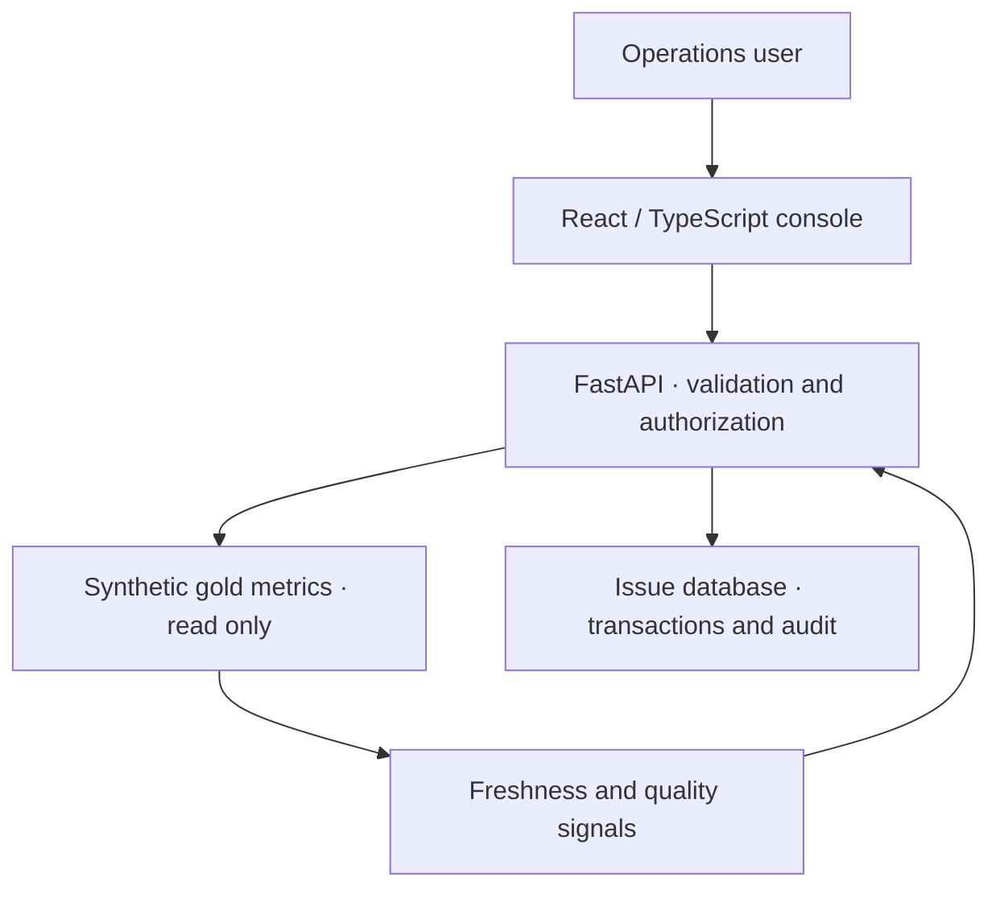
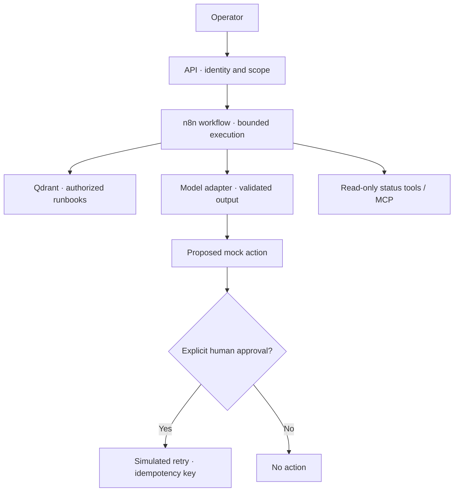
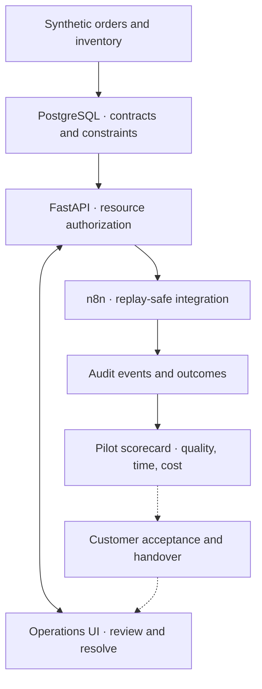
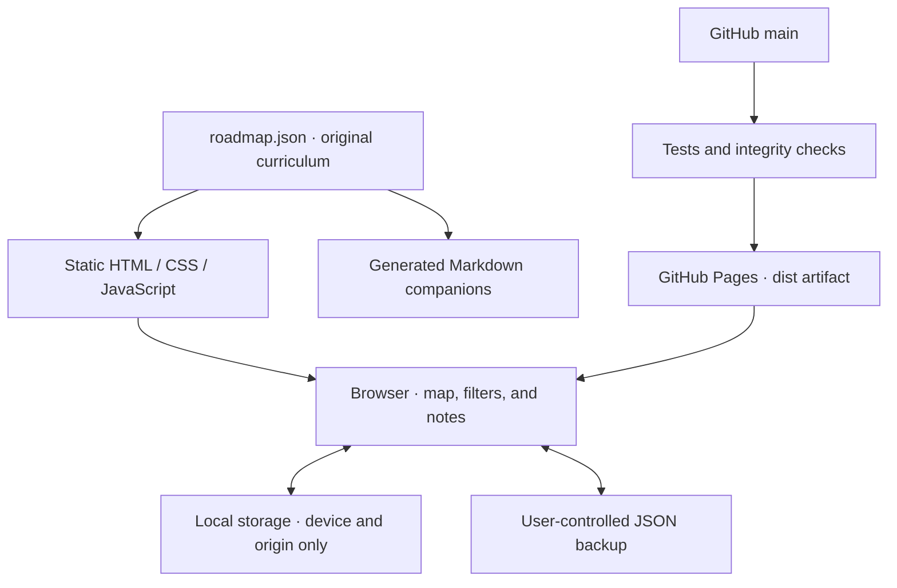

# Architecture proposals

These diagrams describe suggested learning builds, not existing production systems. Keep trust boundaries visible and test them at the server, data, and tool layers.

## Project 01: Operations Console

The console exposes aggregate social-content metrics. Source freshness and missing data are part of the response contract. An operational issue table is separate from the analytical data. Include permission denial tests.

## Project 02: Support Copilot

Propagate a correlation ID across requests. Enforce permissions in the retrieval/tool service, not just the prompt. Version documents and eval cases. Public fixtures and logs must be sanitized. The approval example is a simulation until the operational safety checks are demonstrated.

## Project 03: SME pilot

The fictional distributor scenario uses its own commerce schema. Label EGP assumptions and time comparisons. AI is optional; add it only if a measured workflow need justifies the complexity.

## The roadmap website itself

GitHub Pages hosts static assets. It cannot run the portfolio projects' APIs or keep an API key secret in frontend JavaScript. Those services need a separate runtime when the learning projects are implemented.
